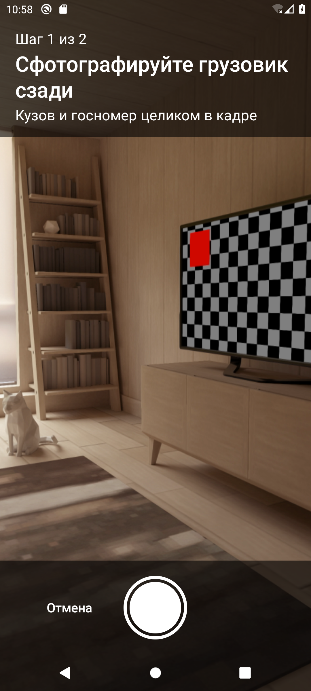

# АРМ водителя: короткая инструкция

Для водителя. Актуально на 17.11.2026, боевое приложение 0.9.14 и новее.

## Перед выездом

1. Проверьте на вкладке «Настройки», что в строке «Водитель» указаны ваши ФИО. Если там другой человек - сразу сообщите сотруднику, который выдал телефон.
2. Откройте «Разнарядка». Она может прийти вечером на завтрашний день. Проверьте машину, адреса и рейсы, затем нажмите **«Ознакомился и принял»**. Это подтверждение маршрута, а не начало смены.
3. В день выезда получите ключи у механика. После их выдачи нажмите **«Начать смену»**. Накануне эту кнопку нажать нельзя.

## Во время каждого рейса

Откройте «Мои рейсы» и отмечайте действия по факту, в таком порядке:

| Порядок | Кнопка | Что потребуется |
|---|---|---|
| 1 | «Прибыл на погрузку» | Нажать по прибытии |
| 2 | «Загрузился, в пути» | Фото грузовика сзади и сбоку |
| 3 | «Прибыл на разгрузку» | Нажать по прибытии |
| 4 | «Разгрузился» | Фото грузовика сзади, сбоку и документа |

Камера подскажет, что снять. Перед переходом дальше проверьте снимок: номер машины, кузов и документы должны быть читаемы. Если документ состоит из нескольких листов, снимите все. Если клиент принял лишь часть груза, укажите остаток в комментарии к «Разгрузился».

## Если рейс выполнить нельзя

- Нажмите **«Не могу выполнить рейс»**, выберите причину и при необходимости напишите комментарий диспетчеру. Это сообщение о проблеме по **ездке**, а не отмена всей разнарядки. Дальнейшее решение принимает диспетчер.
- Причина отказа клиента доступна **после** кнопки «Прибыл на разгрузку». При претензии к качеству обязательно снимите хотя бы одно фото груза. Пока клиент груз не принял, не нажимайте «Разгрузился».
- Если диспетчер изменил адрес или маршрут, проверьте новую карточку и нажмите «Ознакомлен», когда приложение попросит. Уже отмеченные этапы сохраняются.
- Если заменили машину, старая разнарядка останется для просмотра, а работать нужно по новой. Дождитесь ключей от новой машины.

## После рейсов

Сдайте ключи механику и пройдите послерейсовый осмотр у медика. Смену закроет 1С после подтверждения медика. В приложении кнопки «Закончить смену» нет. Если на экране написано, что есть незавершённые рейсы, сообщите диспетчеру и дождитесь его решения либо укажите проблему по конкретному рейсу.

## Связь и обновления

- Если сверху видно **«Не отправлено»**, восстановите интернет и нажмите «Повторить». Если счётчик не исчезает, сообщите диспетчеру. Не удаляйте приложение: в нём могут оставаться неотправленные факты и фото.
- Новая версия скачивается сама. На Android 10/11 каждое обновление нужно подтвердить в системном окне установки. Если приложение просит разрешить установку обновлений, откройте предложенные настройки и включите разрешение для АРМ водителя.
- При спорном адресе, поломке, ошибке 1С или отсутствии разнарядки позвоните диспетчеру. Не отмечайте этапы заранее или за другого водителя.
