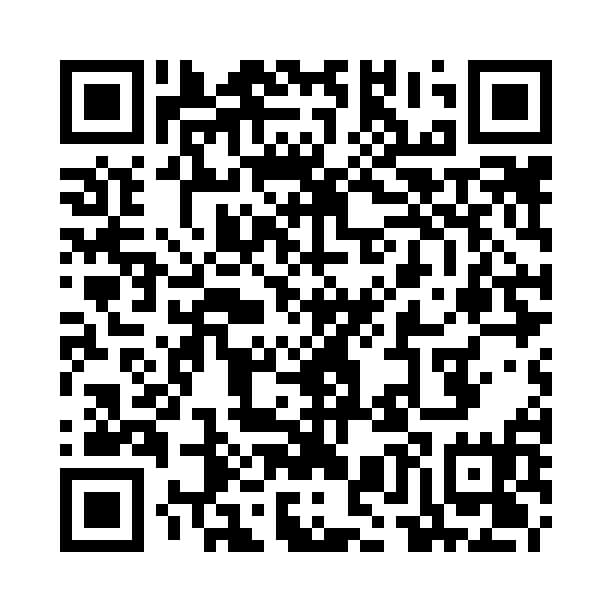
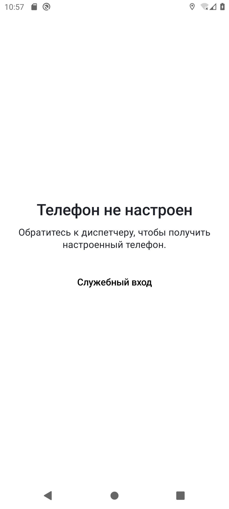
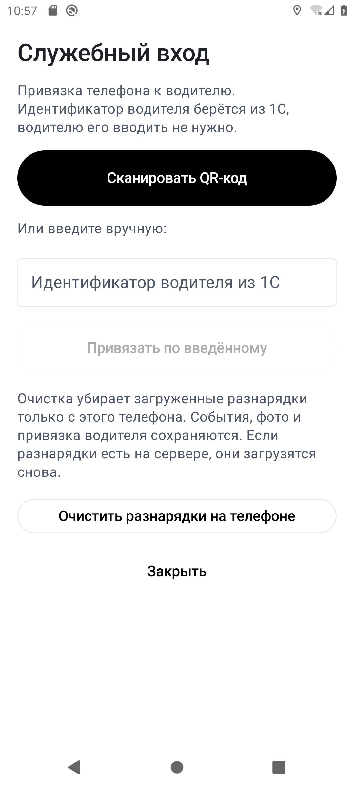
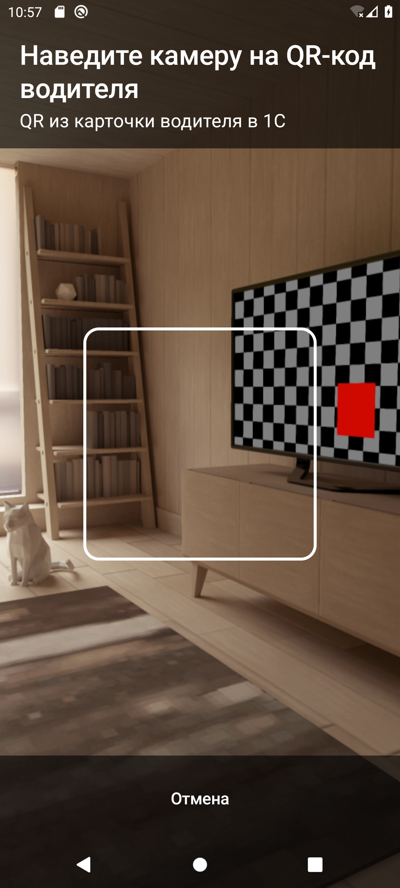

# Выдача телефона с АРМ водителя

Регламент для сотрудника, который готовит и передаёт телефон водителю. Актуально на 16.11.2026, приложение 0.9.13 и новее.

## Перед началом

- Подходит телефон с Android 10 или новее, рабочей камерой, мобильным интернетом и Google Play Services. Для новых закупок предпочтителен Android 13+.
- Нужен QR-код **водителя из его карточки в 1С**. QR для установки приложения и QR водителя - разные коды.
- На 16.11.2026 шлюз подключён к базе `ERP_test3_prtr`. Перед выдачей для реальной смены уточните у ответственного за 1С, что эта среда и разнарядки предназначены для работы. Выдача телефона не переключает базу.
- Не проверяйте работу кнопок рейса на реальной разнарядке: нажатие создаёт факт и отправляет его в 1С.

## 1. Установить приложение

1. Подключите телефон к интернету. Откройте камеру телефона и наведите на QR ниже либо введите в браузере `https://arm-driver.profstroy-services.ru/download`.
2. Проверьте адрес в браузере: `arm-driver.profstroy-services.ru/download`. Он постоянный и всегда отдаёт актуальный подписанный APK.
3. Скачайте файл. Если Android спросит разрешение на установку из браузера, откройте предложенные настройки, разрешите установку **этому браузеру**, вернитесь к файлу и нажмите «Установить».
4. Откройте «АРМ водителя». Не используйте файлы с `-debug.apk` и ссылки из других источников.

## 2. Выдать разрешения

При первом запуске разрешите камеру и геолокацию **при использовании приложения**. На Android 13+ разрешите уведомления. Без камеры водитель не сможет снять этап и сканировать QR; без геолокации событие уйдёт без метки; без уведомлений можно пропустить новую разнарядку.

После запуска на баннере «Разрешите установку обновлений» нажмите «Разрешить» и включите «Разрешить установку» уже для **АРМ водителя**. Это отдельное разрешение от установки APK через браузер. На Android 10/11 каждое следующее обновление водитель подтвердит в системном окне.

## 3. Привязать телефон к водителю

1. На экране «Телефон не настроен» нажмите «Служебный вход».
2. Нажмите «Сканировать QR-код» и считайте QR из карточки нужного водителя в 1С. Если сканирование невозможно, введите его GUID из 1С вручную.
3. Откройте «Настройки»: проверьте ФИО в поле «Водитель» и версию приложения. Если ФИО или идентификатор неверны, не передавайте телефон водителю до исправления привязки.
4. Если разнарядка уже назначена и отправлена из 1С, проверьте, что она видна на вкладке «Разнарядка» и что указан нужный водитель и машина. Отсутствие разнарядки до её отправки из 1С само по себе не ошибка.

<!-- pagebreak -->

## 4. Передать водителю

- Покажите вкладки «Разнарядка», «Мои рейсы», «История», «Настройки».
- Объясните: разнарядку можно прочитать и принять накануне, а «Начать смену» доступно в дату выезда после выдачи ключей механиком.
- Покажите баннер «Не отправлено»: при нём нужно восстановить интернет, нажать «Повторить» и сообщить диспетчеру, если ошибка остаётся. Не удаляйте приложение и его данные при неотправленных событиях или фото.
- Напомните: после рейсов водитель сдаёт ключи и проходит медика; смену закрывает 1С, кнопки окончания смены у водителя нет.

## Если возникла проблема

- APK не устанавливается: проверьте Android 10+, загрузку по указанному домену и разрешение установки для браузера. Если на телефоне стоит `-debug.apk`, перед любым удалением проверьте, нет ли неотправленных фактов и фото.
- QR водителя не считывается: проверьте разрешение камеры и считайте код из карточки водителя в 1С, а не QR установки приложения. Резервный путь - ввод GUID вручную на служебном экране.
- Разнарядка не появилась или есть «Не отправлено»: проверьте интернет, затем обратитесь к диспетчеру или ответственному за обмен с 1С. Не нажимайте этапы повторно «для проверки».

## Контроль перед выдачей

| Проверка | Отметка |
|---|---|
| Интернет работает, Android 10+ и Google Play Services доступны | ____ |
| Приложение установлено по постоянной ссылке, версия проверена в «Настройках» | ____ |
| Камера, геолокация и, на Android 13+, уведомления разрешены | ____ |
| Установка обновлений для АРМ водителя разрешена | ____ |
| Телефон привязан к нужному водителю; ФИО проверено | ____ |
| При наличии разнарядки сверены водитель и машина | ____ |
| Водитель знает про неотправленные события и подтверждение обновлений | ____ |

Дата: __________  Телефон/инвентарный номер: ____________________

Водитель: ____________________  Выдал: ____________________
